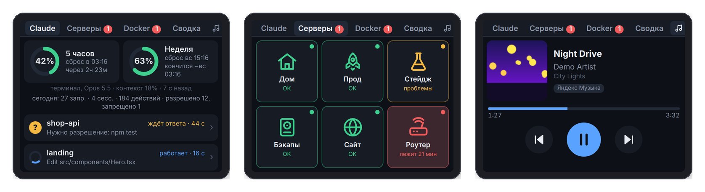
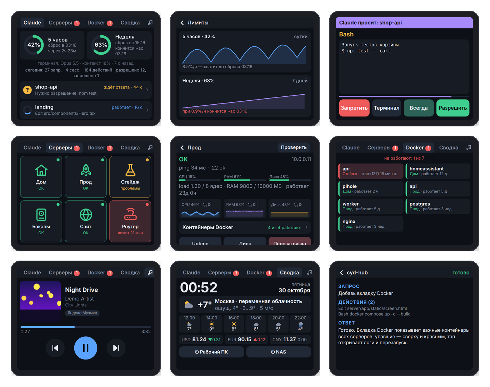

<div align="center">

# CYD Hub

**A desk display on the cheap ESP32 "Cheap Yellow Display": Claude Code sessions, plan limits, servers, Docker and music on one 320×240 screen.**

[](LICENSE)


[Русский](README.md)



</div>

The board is only a screen and a touch panel. A server in Docker renders a 320×240 web page in headless Chromium and sends the board just the tiles that changed. The whole UI is plain HTML/CSS in [`server/app/static/screen.html`](server/app/static/screen.html), so you rarely need to reflash the board.

> The interface is in Russian for now. Translations are welcome.

## Features

- **Claude Code**: what every session is doing (working / waiting / done), the prompt, recent actions and the answer. The board beeps when a session finishes.
- **Permission prompts on the screen**: Allow / Deny / Always / Answer in terminal.
- **Plan limits**: 5-hour and weekly usage, reset times, charts and a "runs out at…" forecast.
- **Servers**: ping, TCP, HTTP, CPU/RAM/disk over SSH with 24 h charts, shown as icon tiles or as a detailed list. SSH command buttons.
- **Docker tab**: the containers you marked as important on every server, failed ones on top; logs, restart and stop from the screen.
- **Music**: whatever plays on your Windows PC (Yandex Music, browser, Spotify…) with cover art, progress and ⏮ ⏯ ⏭ buttons.
- **Dashboard**: clock, weather, exchange rates, Wake-on-LAN.
- **Themes**: 8 presets plus any colors, font and corner radius, all edited live in the browser.
- **Extras**: alarms with sound and the RGB LED, brightness by schedule or light sensor, screensaver, OTA firmware updates.



## Quick start

**Server**

```bash
git clone https://github.com/samsonovAleksandr/CYD_Hub.git
cd CYD_Hub/server
cp .env.example .env          # set ADMIN_PASSWORD and TZ
docker compose up -d --build
```

Open `http://<server>:8770/admin` (user `admin`). The token for the board and the bridge is shown there.

**Board**: in Arduino IDE 2.x install *esp32 by Espressif* (3.0.7), *LovyanGFX* (1.2.34) and *WiFiManager* (2.0.17). Open `firmware/CYDView/CYDView.ino`, select *ESP32 Dev Module* with Partition Scheme *Minimal SPIFFS (1.9MB APP with OTA)* and upload. On first boot calibrate the touch screen, then join the `CYD-Setup` Wi-Fi from your phone, open `192.168.4.1` and enter your Wi-Fi, the hub URL and the token.

**Bridge** (on the PC with Claude Code):

```bash
python bridge/claude_cyd.py install --url http://<server>:8770 --token <token>
```

More details (in Russian): [server](server/README.md) · [bridge](bridge/README.md) · [firmware](firmware/CYDView/README.md) · [case](case/README.md)

## Security

The board and the bridge authenticate with a token, `/admin` is protected by a password. Traffic is plain HTTP inside your LAN, so **do not expose port 8770 to the internet**. SSH credentials of monitored servers are stored in `server/data/config.json`; use a dedicated key and a low-privilege user.

## License

[MIT](LICENSE)
