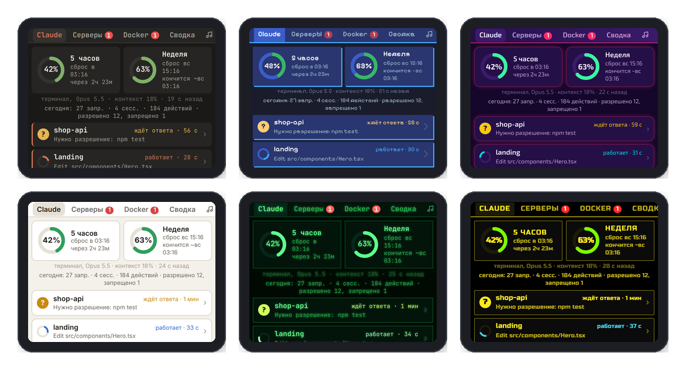
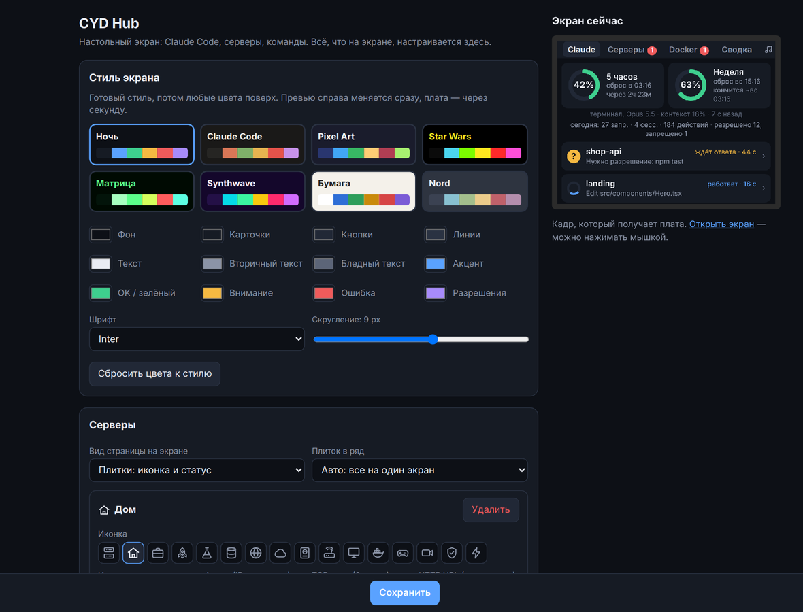
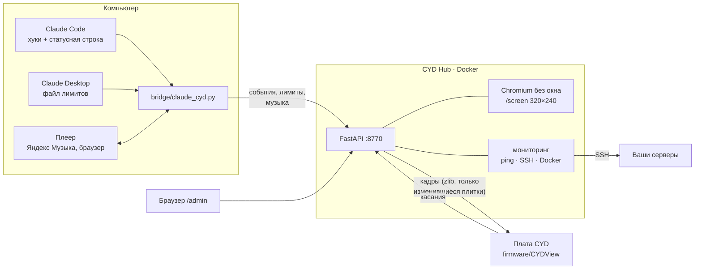

<div align="center">

# CYD Hub

**Настольный экран на дешёвой плате ESP32 «Cheap Yellow Display»: Claude Code, лимиты, серверы, Docker и музыка — на одном экране 320×240.**

[](LICENSE)


[English](README.en.md) · [Возможности](#возможности) · [Установка](#установка) · [Как устроено](#как-устроено) · [Развитие](#развитие)


</div>

Плата здесь — только экран и тач. Всё рисует сервер в Docker: страница 320×240 открыта в Chromium без окна, сервер снимает кадры и отправляет плате только изменившиеся куски. Поэтому дизайн экрана — это обычный HTML/CSS, а прошивать плату заново почти никогда не нужно.

## Возможности

| | |
|---|---|
| **Claude Code** | Над чем работает каждая сессия: «работает», «ждёт ответа», «готово». Тап открывает запрос, последние действия и ответ. Плата пищит, когда сессия закончила. |
| **Разрешения с экрана** | Claude просит запустить команду или изменить файл — на экране кнопки «Разрешить / Запретить / Всегда / В терминале». |
| **Лимиты подписки** | Сколько израсходовано за 5 часов и за неделю, когда сброс, графики и прогноз «кончится ~сб 22:34». Источник — статусная строка `claude` или файл Claude Desktop. |
| **Серверы** | Ping, TCP, HTTP, нагрузка, RAM, диск и графики за сутки по SSH. Плитки с иконками (дом, прод, бэкапы…) или подробный список. Кнопки-команды по SSH. |
| **Docker** | Отдельная вкладка с важными контейнерами всех серверов: упавшие — сверху и красным. Логи, перезапуск, остановка с экрана. |
| **Музыка** | Что играет на компьютере (Яндекс Музыка, браузер, Spotify…): обложка, прогресс, кнопки ⏮ ⏯ ⏭. |
| **Сводка** | Часы, погода, курсы ЦБ, Wake-on-LAN. |
| **Стили** | 8 готовых тем, любые цвета, шрифт и скругление — меняются в браузере, плата подхватывает за секунду. |
| **Мелочи** | Тревога со звуком и RGB-светодиодом, яркость по расписанию или датчику света, заставка, обновление прошивки по Wi-Fi. |

<details open>
<summary><b>Все экраны</b></summary>
<br>

</details>

<details>
<summary><b>Темы</b></summary>
<br>

</details>

<details>
<summary><b>Настройки в браузере</b></summary>
<br>

</details>

## Что понадобится

- **Плата ESP32-2432S028** («Cheap Yellow Display», CYD) — 2.8" 320×240 с тачем, продаётся на AliExpress примерно за 10 $. Подходят обе версии: с одним micro-USB и с micro-USB + USB-C (для второй включите `PANEL_ST7789` в `config.h`).
- **Машина для сервера** с Docker: домашний сервер, NAS, Raspberry Pi 4/5, любой VPS в той же сети, что и плата.
- **Компьютер с Claude Code** (по желанию) — для сессий, лимитов, разрешений и музыки.
- **3D-принтер** (по желанию) — настольный корпус с подставкой лежит в [`case/`](case).

## Установка

### 1. Сервер

```bash
git clone https://github.com/samsonovAleksandr/CYD_Hub.git
cd CYD_Hub/server
cp .env.example .env          # впишите ADMIN_PASSWORD и часовой пояс
docker compose up -d --build
```

Откройте `http://<адрес-сервера>:8770/admin` (логин `admin`, пароль из `.env`). Там добавляются серверы и команды, выбирается стиль и видно живое превью экрана. Там же — **токен** для платы и моста.

### 2. Плата

1. Arduino IDE 2.x → Boards Manager → **esp32 by Espressif** (проверено на 3.0.7).
2. Library Manager → **LovyanGFX** (1.2.34) и **WiFiManager** (2.0.17).
3. Откройте `firmware/CYDView/CYDView.ino`, плата **ESP32 Dev Module**, Partition Scheme **Minimal SPIFFS (1.9MB APP with OTA)**. Загрузите.
4. При первом запуске плата попросит откалибровать тач, а потом поднимет Wi-Fi **CYD-Setup**. Подключитесь с телефона, откройте `192.168.4.1` и укажите сеть, адрес сервера (`http://<адрес-сервера>:8770`) и токен.

Дальше прошивку можно обновлять по Wi-Fi: загрузите `.bin` в `/admin` → «Плата и прошивка». Меню калибровки и настройки сети — если держать BOOT при включении.

### 3. Мост на компьютере (Claude Code, лимиты, музыка)

```bash
python bridge/claude_cyd.py install --url http://<адрес-сервера>:8770 --token <токен>
```

Скрипт проверит связь, допишет хуки и статусную строку в `~/.claude/settings.json` (старая версия сохранится в `.bak`) и на Windows запустит фоновый наблюдатель. Перезапустите сессии Claude Code. Для вкладки «Музыка» на Windows нужны пакеты `winrt-*` — команда в [`bridge/README.md`](bridge/README.md).

Подробнее: [сервер](server/README.md) · [мост](bridge/README.md) · [прошивка](firmware/CYDView/README.md) · [корпус](case/README.md)

## Как устроено



| Папка | Что внутри |
|---|---|
| [`server/`](server) | CYD Hub: FastAPI, рендер экрана в Playwright/Chromium, мониторинг серверов, `/admin` |
| [`server/app/static/screen.html`](server/app/static/screen.html) | Весь интерфейс платы — HTML, CSS и JS. Правите здесь — меняется экран |
| [`firmware/CYDView/`](firmware/CYDView) | Тонкая прошивка: показывает кадры, шлёт касания, светодиод, звук, яркость, OTA |
| [`bridge/`](bridge) | Мост для компьютера: Claude Code, лимиты, музыка. Только стандартная библиотека Python (кроме музыки) |
| [`case/`](case) | Настольный корпус с подставкой (OpenSCAD + STL) |

## Безопасность

- Плата и мост общаются с сервером по токену, `/admin` закрыт паролем. Всё ходит по HTTP внутри домашней сети — **не открывайте порт 8770 в интернет**.
- SSH-пароли и ключи серверов хранятся в `server/data/config.json` на сервере хаба. Заведите для хаба отдельный ключ и отдельного пользователя с минимальными правами.
- «Разрешить» на экране — то же самое, что Enter в диалоге Claude Code. Читайте команду, прежде чем нажимать.

## Развитие

Идеи, которые хочется сделать дальше:

- [ ] проверка свежести бэкапов и срока SSL-сертификатов;
- [ ] прогноз заполнения диска;
- [ ] уведомления в Telegram, когда сервер или контейнер упал;
- [ ] сводка «5/5 OK» в шапке и полоска нагрузки на плитке;
- [ ] готовая прошивка в Releases и прошивка из браузера (ESP Web Tools).

Нашли баг или есть идея — откройте [issue](https://github.com/samsonovAleksandr/CYD_Hub/issues). Как устроен код и как прислать изменения — в [CONTRIBUTING.md](CONTRIBUTING.md).

## Лицензия

[MIT](LICENSE). Шрифты тем скачиваются при сборке образа из Google Fonts (OFL).
