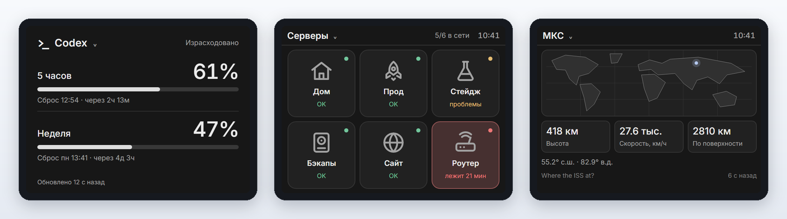
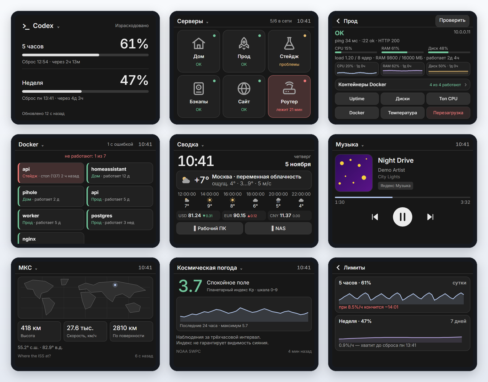
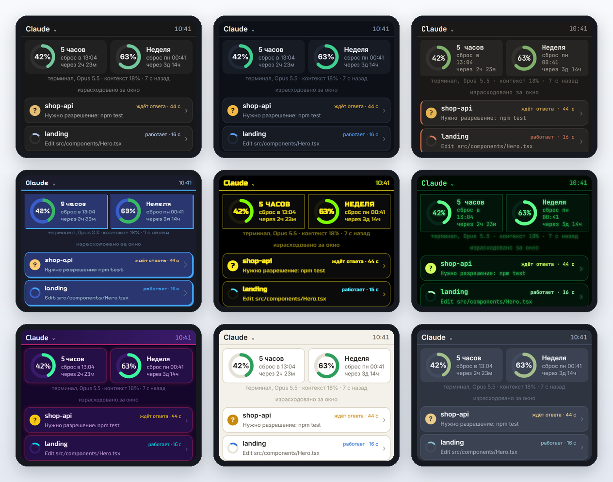
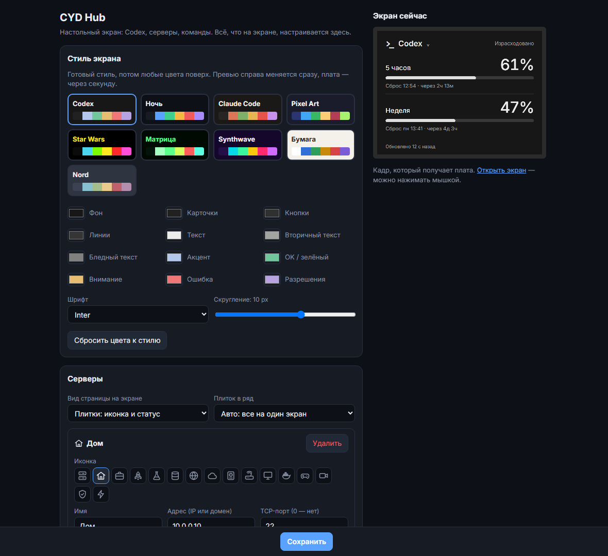
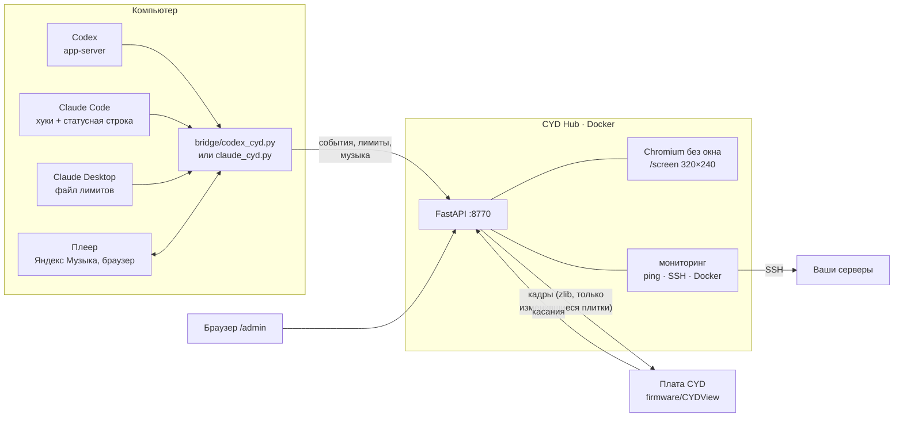

<div align="center">

# CYD Hub

**Настольный экран на дешёвой плате ESP32 «Cheap Yellow Display»: лимиты Codex и Claude Code, серверы, Docker, МКС и музыка — на одном экране 320×240.**

[](LICENSE)


[English](README.en.md) · [Возможности](#возможности) · [Установка](#установка) · [Как устроено](#как-устроено) · [Развитие](#развитие)



</div>

Плата здесь — только экран и тач. Всё рисует сервер в Docker: страница 320×240 открыта в Chromium без окна, сервер снимает кадры и отправляет плате только изменившиеся куски. Поэтому дизайн экрана — это обычный HTML/CSS, а прошивать плату заново почти никогда не нужно.

## Возможности

| | |
|---|---|
| **Лимиты Codex** | Сколько израсходовано за 5 часов и за неделю, когда сброс, графики и прогноз «кончится ~сб 22:34». Цифры берутся из подписки ChatGPT, уже подключённой в Codex; API-ключ не нужен. |
| **Claude Code** | Старый режим: над чем работает каждая сессия, её запрос, последние действия и ответ. Плата пищит, когда сессия закончила. Переключается в `/admin`. |
| **Разрешения с экрана** | В режиме Claude Code: просьба запустить команду или изменить файл показывается с кнопками «Разрешить / Запретить / Всегда / В терминале». |
| **Серверы** | Ping, TCP, HTTP, нагрузка, RAM, диск и графики за сутки по SSH. Плитки с иконками (дом, прод, бэкапы…) или подробный список. Кнопки-команды по SSH. |
| **Docker** | Отдельная вкладка с важными контейнерами всех серверов: упавшие — сверху и красным. Логи, перезапуск, остановка с экрана. |
| **Музыка** | Что играет на компьютере (Яндекс Музыка, браузер, Spotify…): обложка, прогресс, кнопки ⏮ ⏯ ⏭. |
| **Сводка** | Часы, погода, курсы ЦБ, Wake-on-LAN. |
| **МКС и космос** | Положение МКС, высота, скорость и расстояние до вас; наблюдаемый Kp NOAA, график за сутки и уровень магнитной бури. |
| **Стили** | 9 готовых тем, любые цвета, шрифт и скругление — меняются в браузере, плата подхватывает за секунду. |
| **Мелочи** | Тревога со звуком и RGB-светодиодом, яркость по расписанию или датчику света, заставка, разворот экрана 180°, обновление прошивки по Wi-Fi. |

<details open>
<summary><b>Все экраны</b></summary>
<br>

</details>

<details>
<summary><b>Темы</b></summary>
<br>

</details>

<details>
<summary><b>Настройки в браузере</b></summary>
<br>

</details>

## Что понадобится

- **Плата ESP32-2432S028** («Cheap Yellow Display», CYD) — 2.8" 320×240 с тачем, продаётся на AliExpress примерно за 10 $. Подходят обе версии: с одним micro-USB и с micro-USB + USB-C (для второй включите `PANEL_ST7789` в `config.h`).
- **Машина для сервера** с Docker: домашний сервер, NAS, Raspberry Pi 4/5, любой VPS в той же сети, что и плата.
- **Компьютер с Codex** — для лимитов подписки (по умолчанию). По желанию можно вместо него использовать Claude Code: сессии, разрешения, лимиты и музыка.
- **3D-принтер** (по желанию) — готовый корпус для CYD от [ghfisanotti](https://www.thingiverse.com/ghfisanotti) (Thingiverse, CC BY-SA) лежит в [`case/`](case): плоское или наклонное основание и крышка.

## Установка

### 1. Сервер

```bash
git clone https://github.com/samsonovAleksandr/CYD_Hub.git
cd CYD_Hub/server
cp .env.example .env          # впишите ADMIN_PASSWORD и часовой пояс
docker compose up -d --build
```

Откройте `http://<адрес-сервера>:8770/admin` (логин `admin`, пароль из `.env`). Там добавляются серверы и команды, выбирается стиль и видно живое превью экрана. Там же — **токен** для платы и моста.

### 2. Плата

1. Arduino IDE 2.x → Boards Manager → **esp32 by Espressif** (проверено на 3.0.7).
2. Library Manager → **LovyanGFX** (1.2.34) и **WiFiManager** (2.0.17).
3. Откройте `firmware/CYDView/CYDView.ino`, плата **ESP32 Dev Module**, Partition Scheme **Minimal SPIFFS (1.9MB APP with OTA)**. Загрузите.
4. При первом запуске плата попросит откалибровать тач, а потом поднимет Wi-Fi **CYD-Setup**. Подключитесь с телефона, откройте `192.168.4.1` и укажите сеть, адрес сервера (`http://<адрес-сервера>:8770`) и токен.

Дальше прошивку можно обновлять по Wi-Fi: загрузите `.bin` в `/admin` → «Плата и прошивка». Меню калибровки и настройки сети — если держать BOOT при включении.

### 3. Мост на компьютере (лимиты Codex)

```bash
python bridge/codex_cyd.py install --url http://<адрес-сервера>:8770 --token <токен>
python bridge/codex_cyd.py watch
```

`install` проверит Hub и вход в Codex и отправит первый замер, `watch` обновляет лимиты раз в минуту. Подробности и автозагрузка — в [`bridge/README.md`](bridge/README.md).

**Старый режим Claude Code** (сессии, разрешения, музыка) включается в `/admin` → «Источник лимитов» и настраивается через [`bridge/README_CLAUDE.md`](bridge/README_CLAUDE.md). Два моста одновременно не запускаются.

Подробнее: [сервер](server/README.md) · [мост](bridge/README.md) · [прошивка](firmware/CYDView/README.md) · [корпус](case/README.md)

## Как устроено



| Папка | Что внутри |
|---|---|
| [`server/`](server) | CYD Hub: FastAPI, рендер экрана в Playwright/Chromium, мониторинг серверов, `/admin` |
| [`server/app/static/screen.html`](server/app/static/screen.html) | Весь интерфейс платы — HTML, CSS и JS. Правите здесь — меняется экран |
| [`firmware/CYDView/`](firmware/CYDView) | Тонкая прошивка: показывает кадры, шлёт касания, светодиод, звук, яркость, OTA |
| [`bridge/`](bridge) | Мосты для компьютера: лимиты Codex (основной) и Claude Code с музыкой (старый режим). Только стандартная библиотека Python (кроме музыки) |
| [`case/`](case) | Корпус для CYD: STL, исходники FreeCAD и фото. Автор — [ghfisanotti](https://www.thingiverse.com/thing:7047135), CC BY-SA |

## Безопасность

- Плата и мост общаются с сервером по токену, `/admin` закрыт паролем. Всё ходит по HTTP внутри домашней сети — **не открывайте порт 8770 в интернет**.
- SSH-пароли и ключи серверов хранятся в `server/data/config.json` на сервере хаба. Заведите для хаба отдельный ключ и отдельного пользователя с минимальными правами.
- «Разрешить» на экране (старый режим Claude Code) — то же самое, что Enter в диалоге. Читайте команду, прежде чем нажимать.
- Мост Codex не вызывает модель, не читает `auth.json` и не устанавливает хуки: только лимиты через локальный `codex app-server`.

## Развитие

Идеи, которые хочется сделать дальше.

**Интеграции**

- [ ] **Принтер** — вкладка с прогрессом печати, ETA и температурами сопла и стола для Klipper (Moonraker) и OctoPrint, пауза и отмена с экрана;
- [ ] **Weeek** — задачи на сегодня и просроченные, ближайшие встречи, отметка «готово» прямо с экрана (Public API, Bearer-токен);
- [ ] **SourceCraft** — issues, которые ждут ответа, и новые в моих репозиториях (Public API; PR и CI добавим, когда появятся в API);
- [ ] **Уведомления откуда угодно** — `POST /notify` и MQTT: карточка, звук, цвет LED и история; подключается к Home Assistant, n8n и обычным скриптам;
- [ ] **Календарь** — ICS-фид (Google, Nextcloud) со следующей встречей и писком за 5 минут, если встречи не в Weeek.

**Железо**

- [ ] **Здоровье серверов** — SMART и ZFS/RAID, температуры CPU и GPU, пакеты с обновлениями безопасности.

**Экран**

- [ ] **Помидорный таймер** — кольцо на весь экран, цвет LED по фазам, статистика дня и связка с активностью Codex;
- [ ] **Пролёты МКС** — «сегодня 21:14, юго-запад, 4 мин» в существующей вкладке;
- [ ] **QR-код** — ссылка на `/admin`, гостевой Wi-Fi или текущий трек по кнопке;
- [ ] **Лента событий** — одна хронология из CI, контейнеров, встреч и уведомлений, с цветом по важности.

Нашли баг или есть идея — откройте [issue](https://github.com/samsonovAleksandr/CYD_Hub/issues). Как устроен код и как прислать изменения — в [CONTRIBUTING.md](CONTRIBUTING.md).

## Лицензия

[MIT](LICENSE). Шрифты тем скачиваются при сборке образа из Google Fonts (OFL).
