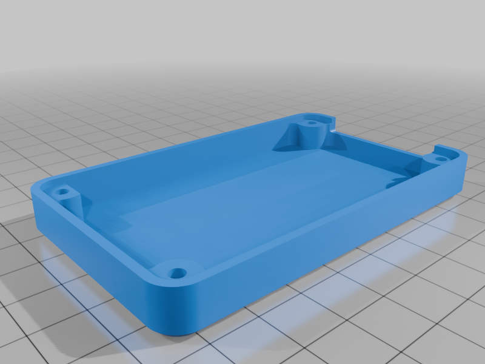
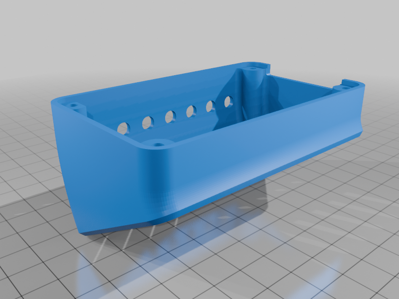
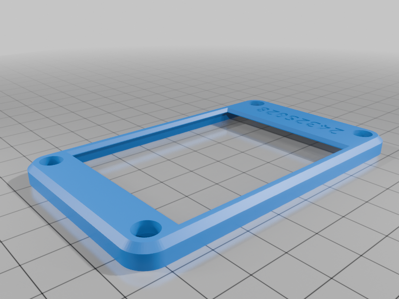
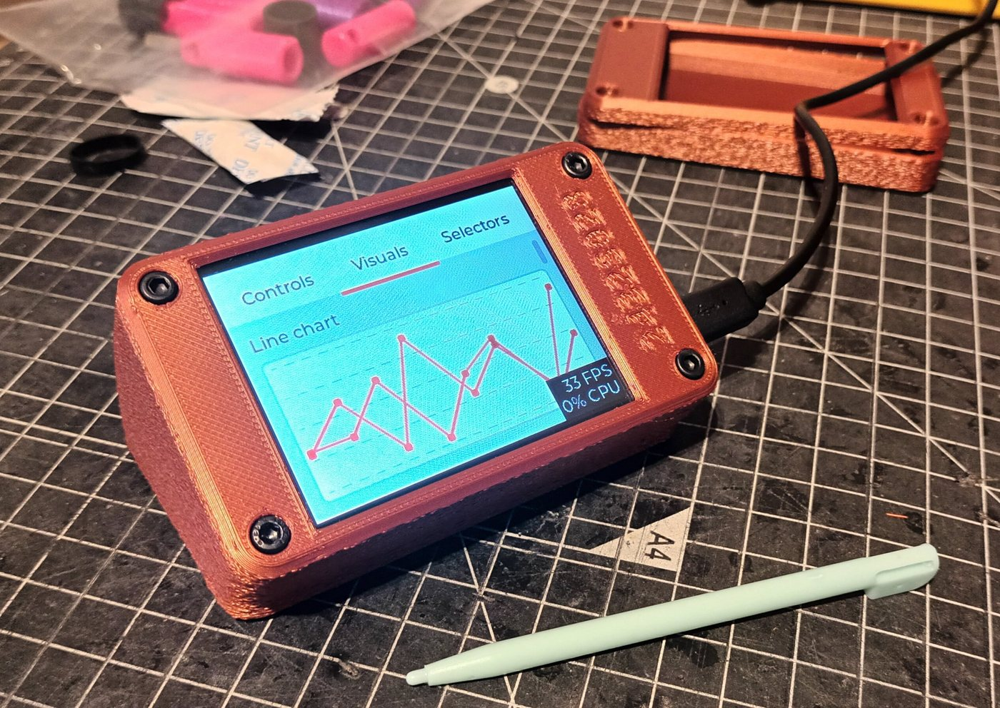
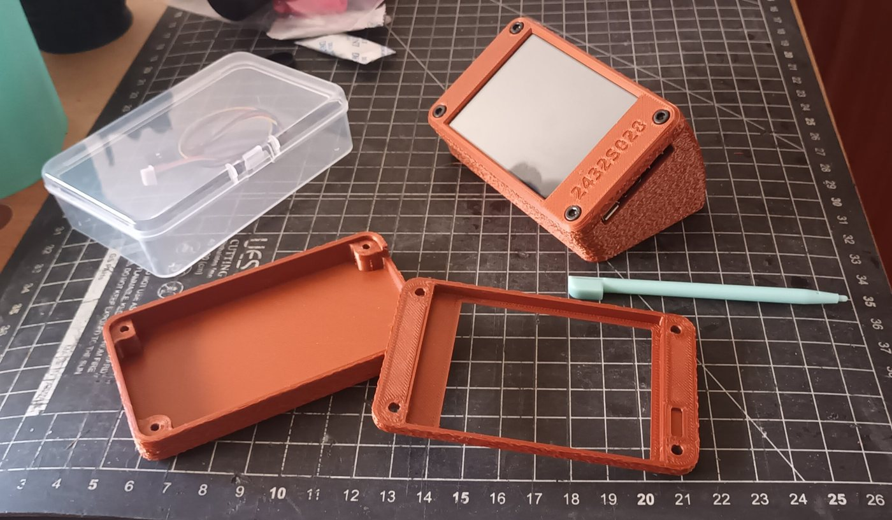
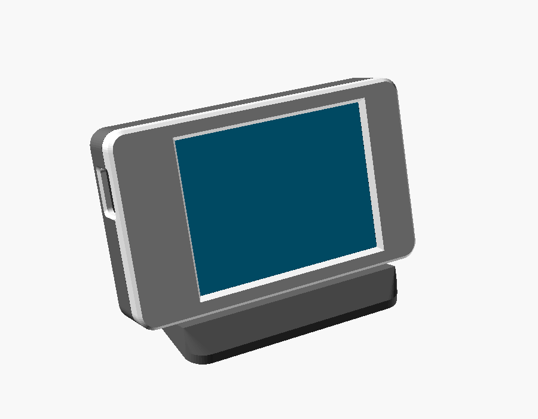
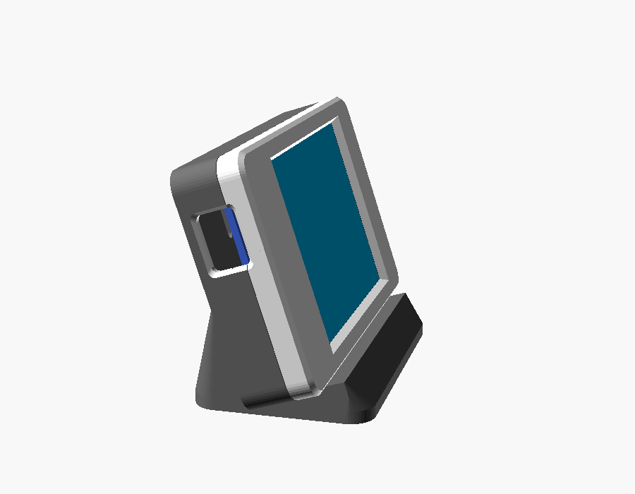
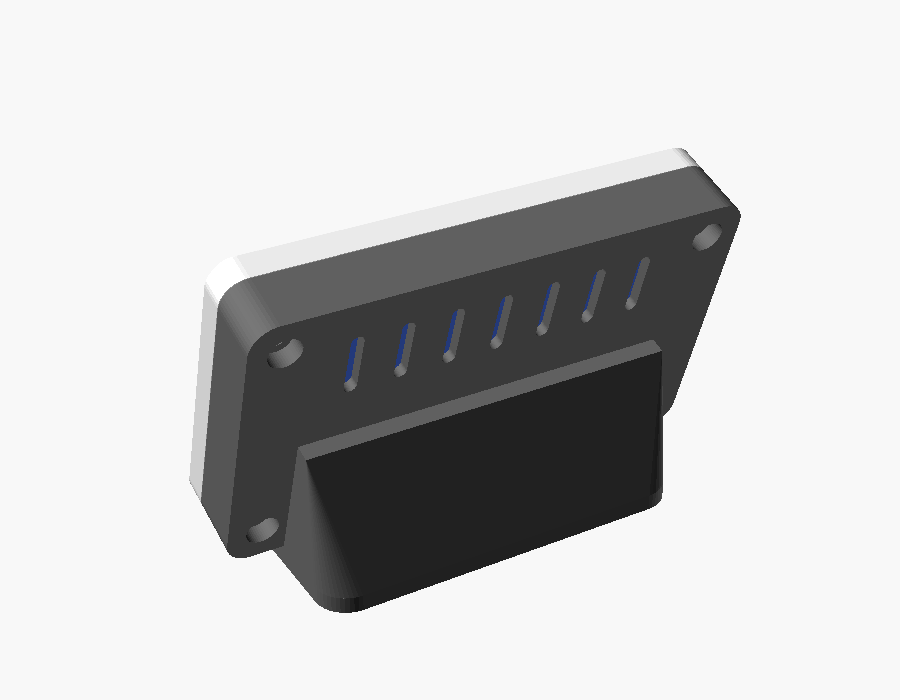

# Корпус

Готовый корпус для **ESP32-2432S028** («Cheap Yellow Display») с экраном 2.8″. Плата кладётся в основание, сверху прикручивается крышка. Есть два основания: плоское и с наклоном 30° — второе удобнее, если экран стоит на столе.

Кейс сделал **ghfisanotti**, оригинал — [ESP32 2432S028 CYD case](https://www.thingiverse.com/thing:7047135) на Thingiverse. Лицензия — **Creative Commons Attribution-ShareAlike 4.0 (CC BY-SA 4.0)**. Файлы кейса распространяются на её условиях, остальной репозиторий — по MIT; подробности в [LICENSE.txt](LICENSE.txt).

<p align="center">
  
  
  
</p>

## Файлы

| Файл | Что это |
|---|---|
| `stl/base-v0.stl` | плоское минимальное основание |
| `stl/base-v1.stl` | основание с наклоном 30° |
| `stl/lid.stl` | крышка с окном экрана, отверстиями под винты и надписью ESP32-2432S028 |
| `source/esp32_2432S028.FCStd` | сборка FreeCAD |
| `source/esp32_2432S028_box.FCStd` | корпус в FreeCAD |
| `source/README.txt` | исходное описание автора |

## Печать и сборка

- **Крепёж:** 4 винта **M3×10** с шестигранной головкой. Резьбовые вставки не нужны.
- **Печать:** PLA или PETG, слой 0.2 мм, 3 периметра. Детали лежат в STL в координатах сборки — включите в слайсере автоматическое опускание на стол. Поддержки обычно не нужны, но проверьте в слайсере.
- Плата укладывается в основание, крышка прижимает её винтами. Окно под экран и разъёмы уже предусмотрены.

<p align="center">
  
  
</p>

## Старый вариант: настольный корпус с подставкой

<details>
<summary><b>OpenSCAD-корпус с подставкой 18° и окном USB</b></summary>
<br>

В `cyd_desk_case.scad` остаётся параметрический корпус с подставкой. Его готовые STL удалены: основной кейс — тот, что выше. Исходник оставлен для тех, кому нужен именно настольный вариант с подставкой и окном под USB.

<p align="center">
  
  
  
</p>

Соберите STL в OpenSCAD 2021+ (`part` = `body`, `front`, `back` или `stand`):

```bash
openscad -o stl/desk_body.stl  -D 'part="body"'  cyd_desk_case.scad
openscad -o stl/desk_front.stl -D 'part="front"' cyd_desk_case.scad
openscad -o stl/desk_back.stl  -D 'part="back"'  cyd_desk_case.scad
openscad -o stl/desk_stand.stl -D 'part="stand"' cyd_desk_case.scad
```

Крепёж старого варианта — 4 винта **M3×12** (или саморезы 3×12). Подставка печатается отдельно, корпус вставляется в неё сверху. Параметры (угол, ширина подставки, положение USB) — в начале `.scad`.

</details>
