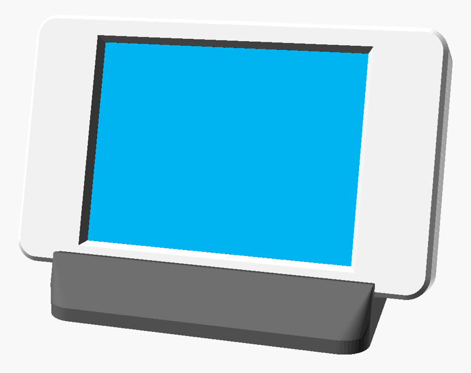
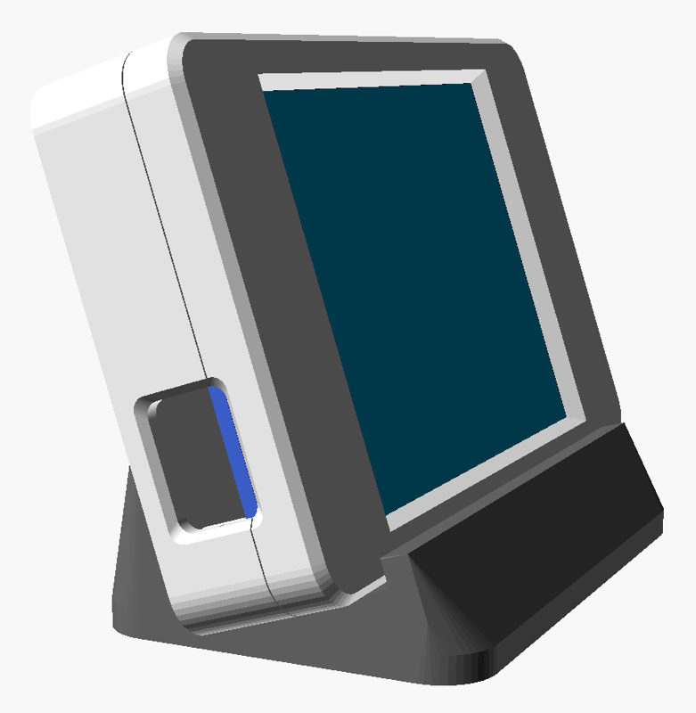
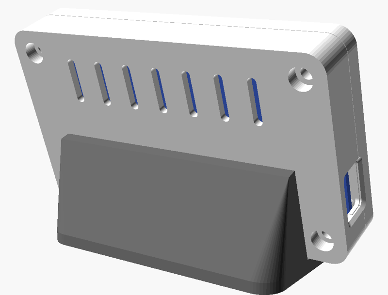

# Настольный корпус с подставкой

`cyd_desk_case.scad` (OpenSCAD 2021+), готовые STL — в `stl/`.

<p align="center">
  
  
  
</p>

Тонкий корпус **91.8 × 55.8 × 17 мм** без аккумулятора: плата питается от кабеля USB. Окно под штекер — в левом торце (если смотреть на экран), 13 × 9 мм со скруглёнными углами и фаской снаружи: в него заходит литая часть штекера. Подставка уже корпуса, так что торцы с кабелем свободны. На задней крышке вентиляционные прорези (ESP32 с постоянно включённым Wi-Fi греется). Корпус вставляется сверху в подставку с наклоном **18°** и вынимается обратно, клей не нужен.

| Деталь | Как печатать |
|---|---|
| `desk_front.stl` | лицом на стол (уже развёрнута), без поддержек |
| `desk_back.stl` | дном на стол, без поддержек |
| `desk_stand.stl` | основанием на стол, без поддержек; 20–30 % заполнения, чтобы была тяжелее |
| `desk_test.stl` | пробная рамка — сначала проверить совпадение отверстий и окна |

PLA или PETG, слой 0.2, 3 периметра. Крепёж: 4 винта **M3×12** (или саморезы 3×12). Под подставку можно наклеить 4 резиновые ножки Ø8 мм, для них есть углубления.

## Перед печатью

1. Размеры платы взяты по типовым чертежам ESP32-2432S028, у разных партий они немного отличаются. Замерьте свою плату и поправьте блок параметров в начале файла: отверстия (`hole_dx/dy`), толщину от платы до верха стекла (`disp_t`), положение micro-USB (`cyd_usb_y` — от нижнего длинного края платы до центра разъёма, `cyd_usb_z` — насколько центр ниже платы).
   - **CYD с двумя USB** (micro-USB + USB-C): поставьте `cyd_usbc = true` и укажите `cyd_usbc_y` — появится второе окно.
   - Толстый штекер не влезает — увеличьте `cyd_usb_w` / `cyd_usb_h`.
2. Напечатайте `desk_test.stl` (~15 минут) и приложите к плате.
3. После правок пересоберите STL: в OpenSCAD поставьте `part = "front"` / `"back"` / `"stand"` → F6 → Export STL, или из консоли:

   ```bash
   openscad -o stl/desk_front.stl -D 'part="front"' cyd_desk_case.scad
   ```

Что ещё можно поменять в начале файла: `tilt` — угол наклона, `stand_w` — ширина подставки, `foot_back` — вылет основания назад (больше — устойчивее), `vents` — вентиляция.
